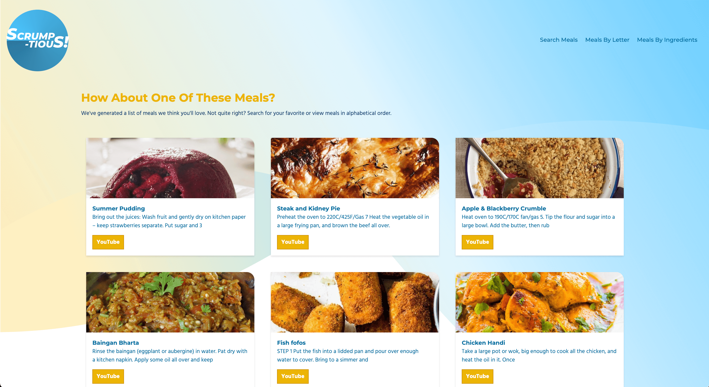

# A Recipe App using the MealDB API Vue 3 + Vite

API: [MealDB](https://www.themealdb.com/api.php)
YouTube Tutorial by [The Codaholic](https://youtu.be/cfiN8lCA3RM)


[Live link on netlify](https://scrumptiousmeals.netlify.app/)


## Browser tests

Install dependencies and the Chromium browser once:

```sh
npm install
npx playwright install chromium
```

Run the tests with `npm run test:e2e`, or use `npm run test:e2e:ui` for the interactive runner. Open the last HTML report with `npm run test:e2e:report`.

The suite runs on desktop and mobile Chromium, covering search restoration, favorites, recipe details, and recipe-specific notes. Each test has isolated browser storage and mocks API responses and remote assets, so no live MealDB access is needed. Playwright starts its own Vite server on port 3100 with a test-only API URL; it does not modify `.env`. Keep that port free before running tests. Failure traces are retained in `test-results/`.
